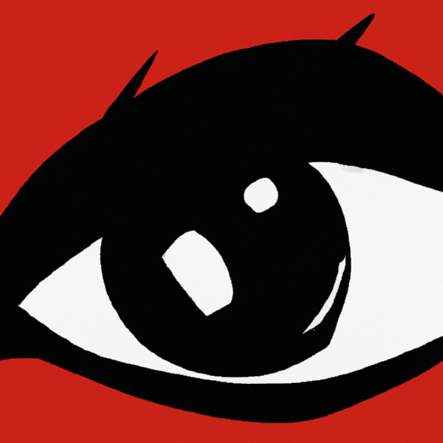

# Amblyopia Plasticity Study - Battery of Tests 

## Overview

Welcome to the Amblyopia Study Test Battery.

This script conducts a series of visual tests to assess various aspects of the amblyopic visual experience. 
If you have questions, contact [Juju Fars](mailto:julien.fars@ndcn.ox.ac.uk).

This battery utilises modified scripts from different researchers:
- Alex S Baldwin (Staircase protocol): [link](https://doi.org/10.5281/zenodo.3266141)
- Jun-Yun Zhang (Dichoptic test): [link](https://doi.org/10.1167/iovs.18-26483)
- Alice Grasso McCaslin (Asteroid test script): [link](https://doi.org/10.1167/tvst.9.9.29)

Inspired by Peter Scarfe's [Psychtoolbox tutorials](https://peterscarfe.com/ptbtutorials.html).

## Table of Contents

1. [Introduction](#introduction)
2. [Experiment Design](#experiment-design)
2.1. [Cutoff](#cutoff)
2.2. [Contrast Sensitivity](#contrast-sensitivity)
2.3. [Interocular Imbalance](interocular-imbalance)
2.4. [Dichoptic](#dichoptic)
2.5. [Asteroid](#asteroid)
2.6. [Snellen E and Snellen E Crowded](#snellen-e-and-snellen-e-crowded)
4. [Extra Information before starting](#extra-information-before-starting)
5. [Contributing](#contributing)
6. [Licence](#licence)

## Introduction

Amblyopia, commonly known as "lazy eye," presents a lifelong visual impairment rooted in disrupted binocular vision processing, often attributed to gamma-aminobutyric acid (GABA)-mediated inhibitory mechanisms. Despite this understanding, the neural mechanisms underlying visual recovery in adult amblyopia remain unclear. Our study investigates the role of GABAergic inhibition in visual improvement, focusing on cortical disinhibition within the primary visual cortex (V1). Using functional magnetic resonance imaging (fMRI) and magnetic resonance spectroscopy (MRS), we aim to elucidate the neural correlates of perceptual training-induced changes in amblyopic individuals. Using a novel binocular phase combination task, we aim to rebalance binocular vision through training. 

In this repository was added all the psychophysical experiments done on the participants before and after the training. This battery of visual tests aim to measure several domains of the visual function such as the visual acuity, the contrast sensitivity, the binocular imbalance of the eyes, the 3D binocular perception and the noise tolerance. These tests were initially performed on Amblyopes after fMRI scanning.   

For more information about the methods and the results, see our [article](tbc).

## Experiment Design

In terms of experimental design, the battery of tests were always following this order: Cutoff, Contrast Sensitivity, Interocular Imbalance, Dichoptic test, Asteroid test, Snellen and Snellen Crowded. Some of those test need to be done subsquently i.e. the Cutoff and the Contrast Sensitivity. For the latter uses the threshold determined by the Cutoff procedure to set up the 6 frequencies of the spatial contrast sensitivity curve (see below for more details). 
When executing the battery of test, most test should be done in the fellow eye before the amblyopic eye. Depending on the 'degree' of amblyopia, the participant may find it easier to first perceive the stimuli through their fellow eye. 
Most of the test are using the stereomode of Psychtoolbox, helped by the combination Display++ - 3D passice glasses. In most tests the stereomode uses vertical lines to interleave the percepts sent to each eye. 

Following are the details of each test.  

### Cutoff 
Assessing the visual acuity of each eye individually and both eyes together in amblyopic individuals is crucial for understanding the extent of visual impairment and potential improvements through intervention. This measurement helps quantify the degree of visual deficit in the amblyopic eye compared to the fellow eye and provides baseline data for evaluating the efficacy of visual perceptual training in enhancing overall visual function.

This test will be done in first. The resulting gabor threshold frequency is used in the following tests: 
- Contrast sensitivity 
- Dichoptic test

This test must be done on each eye individually and on the two eyes binocularly. At the end, 3 CUTOFF frequencies are obtained:
- Fellow Eye (FE)
- Amblyopic Eye (AE) 
- Both Eyes (BE)

### Contrast Sensitivity
Evaluating contrast sensitivity, particularly through spatial contrast sensitivity curves, in each eye individually and both eyes collectively is integral to comprehensively characterizing the visual deficits present in amblyopia. Contrast sensitivity measures the ability to discern subtle differences in luminance between objects, providing valuable information about the visual system's sensitivity to variations in contrast levels across different spatial frequencies. By assessing contrast sensitivity in amblyopic and fellow eyes, as well as binocularly, we can gain insights into the specific spatial frequency bands affected by amblyopia and the degree of binocular summation or suppression present. Spatial contrast sensitivity curves offer a detailed profile of an individual's contrast sensitivity function across a range of spatial frequencies, highlighting any asymmetries or abnormalities in visual processing. Understanding alterations in contrast sensitivity and spatial vision in amblyopic individuals not only aids in diagnosing and monitoring the condition but also guides the development of tailored perceptual training interventions aimed at enhancing visual perception and improving overall visual function.

This test will be done AFTER the Cutoff frequency task (Cutoff frequency is used to set up the 6 frequencies of the current task)
This test must be done on each eye individually and on the two eyes binocularly. At the end we obtain 6x3 contrast thresholds:
- 6 thresholds for the Fellow Eye (FE) obtained using the Cutoff of the FE
- 6 thresholds for the Amblyopic Eye (AE) obtained using the Cutoff of the AE
- 6 thresholds for the Both Eyes (BE) obtained using the Cutoff of BE

### Interocular Imbalance
The Interocular Imbalance test is another critical component of our study, aimed at quantifying and characterizing the degree of asymmetry (ratio between each eye) in visual processing between the amblyopic and fellow eyes in individuals with amblyopia. By systematically assessing the imbalance in visual function between the two eyes, this test provides valuable insights into the degree of amblyopic deficits, such as interocular suppression and dominance. We can elucidate the extent to which the amblyopic eye's input is inhibited by the fellow eye and evaluate the efficacy of perceptual training in restoring binocular function. Understanding the nature and magnitude of interocular imbalance before and after training sheds light on the mechanisms governing binocular vision integration and plasticity in the visual system.

This test must be done on the binocularly. Four different Gabor spatial frequencies are measured. This follows the paradigm and experiment done by [Mao et al. in 2020](https://doi.org/10.1167%2Fiovs.61.8.7). At the end of the test we obtain 4 thresholds, 1 for each frequency. 

The current test can be used to test amblyopes but also people for regular vision. To start the test for people with regular vision, switch the normal_vision variable to 1 in the Interocular_imbalance.m script. Keep the value at 0 to test amblyopes. 

### Dichoptic
The Dichoptic task is employed to quantify interocular suppression and set up the initial noise for the perceptual training that will follow the first session. By presenting distinct visual stimuli to each eye and analyzing their combined percept (Gabors in the AE and noise in FE), this task provides insight into the degree of inhibitory control exerted by the dominant fellow eye over the amblyopic eye. 

This test is only performed once and is mainly used to characterise the maximum tolerable noise that will be used for the first run of the VR training. Because the two tests slightly differ (different setting, screens, etc...), the results from the dichoptic test are purely informative and not aimed to be subject to statistical analysis. 

### Asteroid
This script is adapted from the article of [McCaslin et al., 2020](https://doi.org/10.1167/tvst.9.9.29). We thank Prof. Jenny Read for sending us the Matlab script. 
We modifed the script to allow testing using our rig. 
- modifications: 
    - Use of Display++ stereodisplay
    - modification of ChangeDotColours and ChangeDotCOloursTarget.m 
        these 2 script which were using an outdated RGBA codex
    - modifications of the dots into ovals (to be used with single screen stereodisplay)
    - modifications of the sizes of the 4 areas of dots. The resolution of the Dsiplay++ is smaller than the original screen. But the size of the dots was kept similar relative to the distance (same dva)
The ASTEROID stereotest, was done using a MATLAB/Psychtoolbox/Display++ setting. It assesses stereopsis using only binocular cues. Subjects maintain a standardized distance of 150 cm from the screen, ensuring consistent visual angles. 

### Snellen E and Snellen E crowded 

In addition to specialized experimental paradigms, the inclusion of traditional clinical assessments such as the Snellen and Snellen crowded tests is imperative within our battery of tests. These standardized tests provide a reliable and widely accepted measure of visual acuity, offering a baseline for comparison against the results obtained from experimental tasks. 
The Snellen test involves the presentation of progressively smaller E letters , with participants indicating the orientation of the letter E. Conversely, the Snellen crowded test assesses visual acuity under conditions of visual crowding by presenting letters E within 4 other letters E randomly oriented. This time, the participant must indicate the orientation of the letter in the centre. 
By employing familiar clinical tools alongside novel experimental techniques, we ensure a comprehensive evaluation of visual function that encompasses both functional deficits and clinically relevant metrics. The Snellen and Snellen crowded tests, with their simplicity and ease of administration, serve as valuable adjuncts to our study, facilitating direct comparison with established norms and enabling clinicians to interpret the experimental findings within the broader context of clinical practice. This integrated approach enhances the robustness and clinical relevance of our study, bridging the gap between experimental research and real-world applications in the diagnosis and management of amblyopia.

## Extra Information before starting

The procedure was employed on Matlab version 9 (update R2022b) and Psychtoolbox version 3.0.18. All Matlab default add-ons were installed during the creation of the battery of tests but I do think only the Psychtoolbox and the SR-Research Eyelink toolboxes are mandatory to operate the tests - contact me by email if otherwise.    

## Contributing

To cite one or several experiments presented in this GitHub repository, please use the DOI provided by Zenodo [doi](tbc). Additionally, we kindly request that you cite our article [article_name](tbc). The DOI associated with this repository was added to Zenodo for long-term preservation and citation purposes. We appreciate your acknowledgment of our contributions and hope that our work proves valuable to your endeavors. If you have any questions or require further information, please feel free to contact us. 

## License

CC BY-NC-SA 4.0 Deed
Attribution-NonCommercial-ShareAlike 4.0 International 

This license enables reusers to distribute, remix, adapt, and build upon the material in any medium or format for noncommercial purposes only, and only so long as attribution is given to the creator. If you remix, adapt, or build upon the material, you must license the modified material under identical terms. CC BY-NC-SA includes the following elements:

BY: credit must be given to the creator.
NC: Only noncommercial uses of the work are permitted.
SA: Adaptations must be shared under the same terms.

See [Licence file](LICENCE.md)

---
